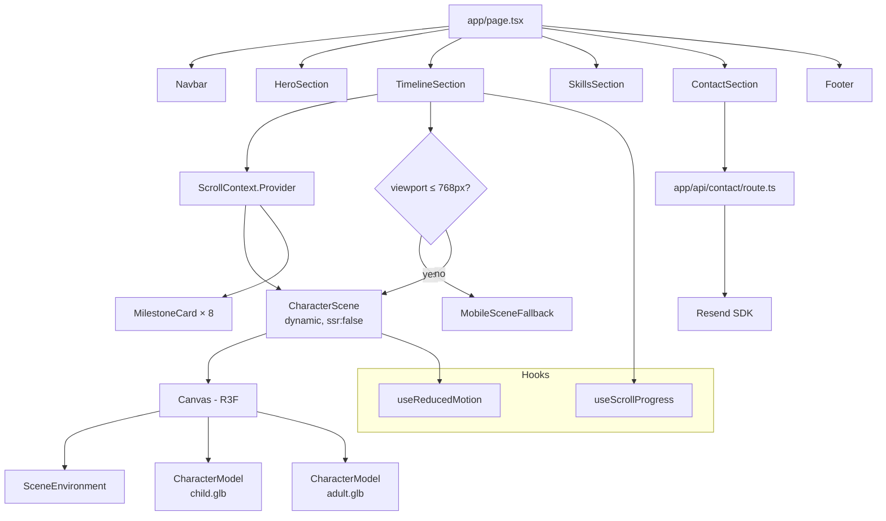

# ADR-002: 3D Timeline Architecture — Portfolio Khuong Nguyen Huu

> Historical design, partly superseded as of 2026-10-30. Read
> [the current handoff](../../AGENTS.md) before implementing changes. The current
> site uses a still hero, a 2D sprite journey and email links; retired Three.js,
> frame-sequence and contact-API requirements below are preserved as history.

**Status:** Accepted\
**Date:** 2026-10-27\
**Deciders:** Designer Agent (Principal Software Architect)\
**Plan Reference:** `docs/requirements/portfolio-3d-timeline.md`\
**Supersedes:** ADR-001 (partially — technology stack is now confirmed, see §1)

---

## 1. Project Structure

Full directory tree of the Next.js 14 App Router project. All source code lives under the workspace root.

```
portfolio/
├── .github/
│   └── workflows/
│       └── ci.yml                     # Lint → typecheck → unit test → build
│
├── app/                               # Next.js App Router root
│   ├── layout.tsx                     # Root layout: fonts, ThemeProvider, metadata
│   ├── page.tsx                       # Single page: assembles all sections
│   ├── globals.css                    # Tailwind base/components/utilities import
│   └── api/
│       └── contact/
│           └── route.ts               # POST /api/contact — Resend integration
│
├── components/
│   ├── layout/
│   │   ├── Navbar.tsx                 # Logo, anchor nav, ThemeToggle, hamburger
│   │   └── Footer.tsx                 # Social links (GitHub, LinkedIn, email)
│   │
│   ├── ui/
│   │   ├── ThemeToggle.tsx            # Dark/light toggle with aria-label
│   │   └── Button.tsx                # Reusable accessible button primitive
│   │
│   ├── sections/
│   │   ├── HeroSection.tsx            # Name, title, tagline, CTA, particles
│   │   ├── TimelineSection.tsx        # Scroll container; owns scroll context
│   │   ├── SkillsSection.tsx          # Categorised skill chips
│   │   ├── ContactSection.tsx         # Controlled form + validation + submission
│   │   └── MilestoneCard.tsx          # Single milestone; Framer Motion entrance
│   │
│   └── three/
│       ├── CharacterScene.tsx         # R3F <Canvas>; loads models; drives anim
│       ├── CharacterModel.tsx         # Renders one glTF model at opacity α
│       ├── SceneEnvironment.tsx       # Lighting, environment map, camera setup
│       └── MobileSceneFallback.tsx    # Static  shown on mobile
│
├── lib/
│   ├── data/
│   │   ├── timeline.ts                # 8 Milestone objects (CV data)
│   │   └── skills.ts                  # Skill[] objects grouped by category
│   │
│   ├── hooks/
│   │   ├── useScrollProgress.ts       # Maps section scroll → [0, 1]
│   │   └── useReducedMotion.ts        # Reads prefers-reduced-motion
│   │
│   ├── context/
│   │   └── ScrollContext.tsx          # React context carrying scrollProgress
│   │
│   ├── utils/
│   │   └── contact.ts                 # ContactPayload schema validation (Zod)
│   │
│   └── types.ts                       # All shared TypeScript interfaces
│
├── public/
│   ├── models/
│   │   ├── character-child.glb        # Low-poly child glTF model (CC0)
│   │   └── character-adult.glb        # Low-poly adult glTF model (CC0)
│   ├── fonts/                         # Self-hosted variable fonts
│   ├── images/
│   │   ├── og-image.png               # Open Graph 1200×630
│   │   └── timeline-fallback.png      # Mobile static illustration
│   ├── sitemap.xml
│   └── robots.txt
│
├── styles/                            # (empty — globals.css lives in app/)
│
├── tests/
│   ├── unit/
│   │   ├── useScrollProgress.test.ts
│   │   ├── contact-validation.test.ts
│   │   ├── MilestoneCard.test.tsx
│   │   └── ContactSection.test.tsx
│   └── e2e/
│       ├── smoke.spec.ts              # Page load, section presence
│       ├── timeline.spec.ts           # Scroll interaction
│       └── contact.spec.ts            # Form validation + mock submission
│
├── .env.example                       # Documents RESEND_API_KEY
├── .gitignore
├── next.config.ts                     # transpilePackages for three.js ecosystem
├── tailwind.config.ts                 # Theme extension, dark mode 'class'
├── tsconfig.json                      # strict: true, paths alias @/*→src
├── vitest.config.ts                   # jsdom env, coverage thresholds
├── playwright.config.ts               # Base URL, single browser for CI
└── package.json
```

### Technology Stack (confirmed — supersedes ADR-001 recommendation)

| Concern | Choice | Version |
|---|---|---|
| Framework | Next.js (App Router) | 14.x |
| Language | TypeScript (strict) | 5.x |
| Styling | Tailwind CSS | 3.x |
| 3D rendering | @react-three/fiber | 8.x |
| 3D helpers | @react-three/drei | 9.x |
| 2D animation | Framer Motion | 11.x |
| Schema validation | Zod | 3.x |
| Email delivery | Resend SDK | 3.x |
| Unit tests | Vitest + React Testing Library | latest stable |
| E2E tests | Playwright | latest stable |
| Linting | ESLint (next/core-web-vitals) | — |
| Formatting | Prettier | — |
| Deployment | Vercel (Next.js preset) | — |
| CI | GitHub Actions | — |

---

## 2. Data Model

All interfaces live in `lib/types.ts` and are imported wherever needed.

```typescript
// lib/types.ts

// ─── Timeline ────────────────────────────────────────────────────────────────

export type MilestoneKind = "education" | "job" | "origin";

export interface Milestone {
  /** Unique sequential identifier (0-indexed, 0 = origin/childhood anchor) */
  id: number;
  kind: MilestoneKind;
  /** ISO date string "YYYY-MM" or "present" */
  startDate: string;
  /** ISO date string "YYYY-MM" or "present" */
  endDate: string;
  /** Display-ready label, e.g. "Jul 2017 – Oct 2019" */
  dateLabel: string;
  role: string;
  company: string;
  /** 1–3 sentence description shown in MilestoneCard */
  description: string;
  /** Lucide icon name or custom SVG identifier */
  iconName: string;
  /**
   * Scroll-progress value [0, 1] at which this milestone should be
   * considered "active" (card becomes fully visible).
   * Evenly distributed: milestone[i].triggerAt = i / (MILESTONE_COUNT - 1)
   */
  triggerAt: number;
}

// ─── Skills ──────────────────────────────────────────────────────────────────

export type SkillCategory =
  | "Languages"
  | "Frameworks & Libraries"
  | "Tooling & Build"
  | "Testing"
  | "Cloud & DevOps"
  | "Design & Accessibility";

export interface Skill {
  id: string;          // kebab-case, e.g. "react"
  label: string;       // Display label, e.g. "React"
  category: SkillCategory;
  /** 1–5 proficiency indicator (optional; used for visual weight only) */
  proficiency?: 1 | 2 | 3 | 4 | 5;
}

// ─── Contact ─────────────────────────────────────────────────────────────────

export interface ContactPayload {
  name: string;        // 1–100 chars
  email: string;       // valid RFC 5322 address
  message: string;     // 1–2000 chars
}

export interface ContactResponse {
  success: boolean;
  message: string;     // Human-readable feedback
}

// ─── Project (reserved for future "Projects" section) ─────────────────────

export interface Project {
  id: string;
  title: string;
  description: string;
  techStack: string[];
  repoUrl?: string;
  liveUrl?: string;
  thumbnailSrc: string;
}
```

### Timeline Data Shape (from CV)

The 8 `Milestone` objects in `lib/data/timeline.ts` must conform to the interface above.
Milestone 0 (`id: 0, kind: "origin"`) is a synthetic "Childhood / Before Career" anchor used to
establish the child model state at scroll progress 0. Milestones 1–7 map to the seven CV entries.

| id | kind | startDate | endDate | role | company |
|---|---|---|---|---|---|
| 0 | origin | "2000-01" | "2013-07" | "Childhood" | "— " |
| 1 | education | "2013-08" | "2017-12" | "Student" | "HUTECH University" |
| 2 | job | "2017-07" | "2019-10" | "Junior FE Developer" | "FPT Software (ODMS)" |
| 3 | job | "2019-10" | "2021-03" | "Middle FE Developer" | "ORIENT Software (Retail DDS)" |
| 4 | job | "2021-03" | "2022-10" | "Senior Front-end Engineer" | "FPT Software (Buyer Red Line)" |
| 5 | job | "2022-10" | "2024-07" | "Senior FE / Team Lead" | "FPT Software (Classpad)" |
| 6 | job | "2024-07" | "2024-11" | "Senior FE Tech Lead" | "FPT Software (Costco)" |
| 7 | job | "2024-12" | "present" | "Senior FE / Solution Architect" | "FPT Software (NewKong2)" |

`triggerAt` values (evenly distributed across 8 entries, indices 0–7):
`0.00, 0.143, 0.286, 0.429, 0.571, 0.714, 0.857, 1.00`

---

## 3. Three.js Architecture

### 3.1 Overview

The 3D scene is rendered by `@react-three/fiber` inside a Next.js `dynamic()` import
with `{ ssr: false }` to prevent server-side rendering of WebGL code.

```
app/page.tsx
 └── dynamic(() => import("components/three/CharacterScene"), { ssr: false })
       └── <Canvas>  (R3F)
             ├── <SceneEnvironment />   — lights, env map, camera
             ├── <CharacterModel />     — child model at opacity (1 - progress)
             └── <CharacterModel />     — adult model at opacity progress
```

### 3.2 `<CharacterScene>` Responsibilities

- Receives `scrollProgress: number` (0→1) from `ScrollContext`.
- Reads `prefersReducedMotion` from `useReducedMotion()`.
- Renders a full-viewport `<Canvas>` with `frameloop="demand"` (renders only when props change — saves GPU on idle).
- Passes `childOpacity = prefersReducedMotion ? 0 : 1 - scrollProgress` to the child `<CharacterModel>`.
- Passes `adultOpacity = prefersReducedMotion ? 1 : scrollProgress` to the adult `<CharacterModel>`.
- When `prefersReducedMotion` is `true`, skips all animation and shows only the adult model at full opacity.

### 3.3 `<CharacterModel>` Responsibilities

- Accepts `{ modelPath: string; opacity: number; position?: Vector3; scale?: number }`.
- Loads the GLB via `useGLTF(modelPath)` (drei).
- Applies `opacity` to the model's material using `MeshStandardMaterial` with `transparent: true`.
- Plays the model's first idle animation clip (if present) via `useAnimations` (drei).
- Pauses animation playback when `opacity === 0` for performance.

### 3.4 `<SceneEnvironment>` Responsibilities

- Adds `<ambientLight intensity={0.4} />` and `<directionalLight position={[5, 10, 5]} />`.
- Uses drei `<Environment preset="city" />` for image-based lighting.
- Sets camera at `[0, 1.6, 4]` (eye level, 4 units back).
- Uses `<OrbitControls enableZoom={false} enablePan={false} />` for subtle look-around; auto-rotate off.

### 3.5 Model Asset Specification

| Asset | File | Poly budget | Rig requirement |
|---|---|---|---|
| Child character | `public/models/character-child.glb` | ≤ 10k tris | Optional idle animation clip |
| Adult character | `public/models/character-adult.glb` | ≤ 10k tris | Optional idle animation clip |

Source: CC0 licensed models from Mixamo or Sketchfab (to be downloaded and placed by developer).
Both models must share the same world-space origin and face the same direction (+Z forward)
so the cross-fade is visually coherent.

---

## 4. Scroll-to-Animation Mapping

### 4.1 `useScrollProgress` Hook

```
Inputs:  ref to the <TimelineSection> DOM element
Output:  scrollProgress ∈ [0.0, 1.0]

Logic:
  elementTop    = section.getBoundingClientRect().top + window.scrollY
  elementHeight = section.offsetHeight
  scrollY       = window.scrollY
  raw           = (scrollY - elementTop) / (elementHeight - window.innerHeight)
  scrollProgress = clamp(raw, 0, 1)
```

The hook attaches a `scroll` event listener (passive: true) on `window` and uses
`requestAnimationFrame` batching to avoid layout thrash. It is cleaned up on unmount.

### 4.2 Milestone Activation

A milestone card is considered "active" (visible / animated in) when:
```
scrollProgress >= milestone.triggerAt - 0.05   // 5% lead-in
```

The `<TimelineSection>` iterates milestones and passes an `isVisible: boolean` prop
to each `<MilestoneCard>`. `<MilestoneCard>` then uses Framer Motion `motion.div`
with `animate={{ opacity: isVisible ? 1 : 0, y: isVisible ? 0 : 24 }}`.

### 4.3 Character Cross-Fade Curve

Linear interpolation is used by default (sufficient for a smooth visual transition).
If the designer wants an eased curve, the value should pass through an easing function
before being sent to `<CharacterScene>`:

```
// Optional — apply in TimelineSection.tsx before passing to context
easedProgress = easeInOutCubic(scrollProgress)
```

`easeInOutCubic(t) = t < 0.5 ? 4t³ : 1 - (-2t + 2)³ / 2`

### 4.4 Scroll Context Flow

```
<TimelineSection>
  ├── useScrollProgress(ref)          → scrollProgress
  ├── <ScrollContext.Provider value={scrollProgress}>
  │     ├── <CharacterScene />        reads scrollProgress via useContext
  │     └── milestone cards array     derives isVisible per card
```

`ScrollContext` is defined in `lib/context/ScrollContext.tsx` and exports:
- `ScrollContext` — React context (`number`, default `0`)
- `useScrollContext()` — typed hook that throws if used outside provider

---

## 5. Component Diagram (Mermaid)



---

## 6. API Contract

### POST /api/contact

**File:** `app/api/contact/route.ts`\
**Auth required:** No\
**Rate limit:** 5 requests per IP per 10 minutes (enforced via in-memory `Map` or Vercel's Edge rate-limiting header; see §7)

#### Request

```typescript
// Content-Type: application/json
type ContactRequest = {
  name: string;     // required, 1–100 chars
  email: string;    // required, valid email
  message: string;  // required, 1–2000 chars
};
```

#### Responses

```typescript
// 200 OK — email sent successfully
type ContactResponse200 = {
  success: true;
  message: "Your message has been sent. I'll get back to you soon!";
};

// 400 Bad Request — validation failed
type ContactResponse400 = {
  success: false;
  message: string;      // human-readable validation error
  errors?: {            // optional field-level detail
    field: "name" | "email" | "message";
    issue: string;
  }[];
};

// 429 Too Many Requests
type ContactResponse429 = {
  success: false;
  message: "Too many requests. Please try again later.";
};

// 500 Internal Server Error — Resend failure
type ContactResponse500 = {
  success: false;
  message: "Failed to send message. Please try again later.";
};
```

#### Implementation Notes

1. Parse and validate the body with `Zod` (schema defined in `lib/utils/contact.ts`).
2. On validation failure, return 400 with field-level errors.
3. Call `resend.emails.send(...)` with `from: "Portfolio Contact <onboarding@resend.dev>"` (Resend test domain) or a custom verified domain.
4. On Resend error, log server-side (never expose SDK error details to client) and return 500.
5. The `RESEND_API_KEY` environment variable is read via `process.env.RESEND_API_KEY`; the route throws at startup if it is undefined.

#### Zod Schema (spec — not implementation code)

```typescript
// lib/utils/contact.ts
const ContactSchema = z.object({
  name:    z.string().min(1).max(100),
  email:   z.string().email(),
  message: z.string().min(1).max(2000),
});
```

---

## 7. Security Controls

### 7.1 Input Sanitisation

- All contact form input is validated server-side with Zod before any processing.
- Client-side validation mirrors the Zod schema (using the same schema via a shared import) — this is a UX aid only, never a security boundary.
- `message` field is never rendered as raw HTML on the server; Resend sends it as plain text.
- No SQL queries in this project — no SQL injection surface.

### 7.2 Rate Limiting

- **Development:** A lightweight in-memory rate limiter is implemented in the API route using a `Map<string, { count: number; resetAt: number }>` keyed on `x-forwarded-for` (or `request.ip` in Vercel Edge).
- **Production:** Enable Vercel's WAF / Rate Limiting product (or add `@upstash/ratelimit` + Upstash Redis) before launch. The in-memory solution is documented as a development placeholder.
- The rate limit is: **5 requests per IP per 600 seconds** (10 minutes).

### 7.3 Environment Variables

| Variable | Required | Description |
|---|---|---|
| `RESEND_API_KEY` | Yes | Resend API key for email delivery |
| `NODE_ENV` | Auto | Set by Next.js |
| `CONTACT_TO_EMAIL` | Recommended | Recipient email address (defaults to a hardcoded value if absent) |

- All secrets are stored in `.env` (gitignored).
- `.env.example` documents `RESEND_API_KEY` and `CONTACT_TO_EMAIL` without values.
- The API route reads `process.env.RESEND_API_KEY` at runtime; if undefined in production, it returns 500 with a safe error message.

### 7.4 HTTP Security Headers

Add the following to `next.config.ts` via `headers()`:

| Header | Value |
|---|---|
| `X-Content-Type-Options` | `nosniff` |
| `X-Frame-Options` | `DENY` |
| `Referrer-Policy` | `strict-origin-when-cross-origin` |
| `Permissions-Policy` | `camera=(), microphone=(), geolocation=()` |
| `Content-Security-Policy` | `default-src 'self'; script-src 'self' 'unsafe-eval'; style-src 'self' 'unsafe-inline'; img-src 'self' data: blob:; connect-src 'self' https://api.resend.com; worker-src blob:` |

> **Note:** `unsafe-eval` is required by Three.js/WebGL shader compilation. `unsafe-inline` for styles is required by Tailwind's JIT output. Both are acceptable trade-offs for a portfolio; document this explicitly.

### 7.5 CORS

The contact API route is only called from same-origin requests (Next.js SPA). No CORS headers need to be added; the default Next.js behaviour (deny cross-origin) is correct.

---

## 8. Performance Strategy

### 8.1 3D Canvas Loading

```typescript
// app/page.tsx
const CharacterScene = dynamic(
  () => import("@/components/three/CharacterScene"),
  {
    ssr: false,
    loading: () => <CanvasLoadingSpinner />,   // lightweight CSS spinner
  }
);
```

- The Three.js bundle (≈ 600 kB gzipped) is split into a separate async chunk.
- `<Suspense>` wraps the dynamic import at the section level.
- `<Canvas frameloop="demand">` ensures WebGL renders only when `scrollProgress` changes, not on every browser frame.
- `useGLTF.preload("/models/character-child.glb")` and `.preload("/models/character-adult.glb")` are called at module level in `CharacterScene.tsx` so models begin downloading before the canvas mounts.

### 8.2 Model Optimisation

- Both GLB files must be processed through **gltf-pipeline** or **gltfjsx** before commit:
  - Draco compression enabled (reduces model size ≈ 70%).
  - Unused morph targets stripped.
  - Textures converted to WebP and resized to 512×512.
- Target GLB sizes: child ≤ 500 kB, adult ≤ 500 kB after compression.

### 8.3 Image & Font Optimisation

- All raster images served via `next/image` for automatic format negotiation and lazy loading.
- Fonts loaded via `next/font/local` (self-hosted variable font) with `display: swap` and `preload: true`.
- `og-image.png` is static (1200×630, ≤ 200 kB).

### 8.4 Code Splitting

- `<SkillsSection>`, `<ContactSection>`, and `<Footer>` are loaded eagerly (small size, below fold).
- `<CharacterScene>` is the only `dynamic()` import; all other splits are automatic by Next.js.

### 8.5 Bundle Size Budget

| Chunk | Target gzipped size |
|---|---|
| First load JS (shared) | ≤ 80 kB |
| Page JS | ≤ 50 kB |
| Three.js async chunk | ≤ 650 kB |
| GLB models (total) | ≤ 1 MB |

---

## 9. Accessibility Strategy

### 9.1 Reduced Motion

```typescript
// lib/hooks/useReducedMotion.ts
// Returns true when the OS has prefers-reduced-motion: reduce
```

- `useReducedMotion()` is consumed by:
  - `<CharacterScene>` — disables cross-fade; shows only adult model statically.
  - `<MilestoneCard>` — disables Framer Motion entrance animation; cards render fully visible immediately.
  - `<HeroSection>` — disables particle animation.
- The hook is implemented using `window.matchMedia("(prefers-reduced-motion: reduce)")` with a `change` event listener for live updates.

### 9.2 Canvas ARIA

```html
<!-- CharacterScene.tsx wrapping div -->
<div
  role="img"
  aria-label="3D character representing career growth from childhood to senior engineer"
>
  <Canvas ...>
```

- The `<Canvas>` element itself does not accept `aria-*`; the wrapping `<div>` carries the semantic role.
- On mobile, `<MobileSceneFallback>` renders a static `` with `alt="Career journey timeline illustration"`.

### 9.3 Keyboard Navigation

- All anchor links (`<a>`) and buttons are native HTML elements — keyboard accessible by default.
- `<ThemeToggle>` is a `<button>` with `aria-label="Switch to light mode"` / `"Switch to dark mode"` (toggled dynamically).
- `<Navbar>` hamburger button: `aria-expanded`, `aria-controls="mobile-menu"`, `aria-label="Open navigation menu"`.
- Focus trap is applied to the open mobile menu using a minimal custom hook (no library required for a simple 5-link menu).
- Visible focus rings use Tailwind's `focus-visible:ring-2 focus-visible:ring-offset-2` utility on all interactive elements.

### 9.4 Colour Contrast

- All body text uses Tailwind's `text-gray-900 dark:text-gray-100` which meets WCAG AA (≥ 4.5:1) on the chosen background colours.
- Milestone card accent colours are validated against both light and dark backgrounds.
- A contrast audit pass is required before the first production deploy (manual step; automated tooling can only assist).

### 9.5 Form Accessibility

- `<ContactSection>` uses native `<label for="...">` / `id` pairs for each field.
- Invalid fields receive `aria-invalid="true"` and `aria-describedby` pointing to the inline error message.
- Success and error banners use `role="status"` / `role="alert"` respectively for live-region announcement.

### 9.6 Skip Link

```html
<!-- app/layout.tsx — first child of <body> -->
<a href="#main-content" class="sr-only focus:not-sr-only ...">
  Skip to main content
</a>
```

---

## 10. Test Strategy

### 10.1 Unit Tests (Vitest + React Testing Library)

| Test file | What is tested | Acceptance criteria covered |
|---|---|---|
| `useScrollProgress.test.ts` | clamp at 0 and 1; correct ratio calculation; cleanup on unmount | AC-06 (indirectly) |
| `contact-validation.test.ts` | Zod schema accepts valid payload; rejects empty name; rejects invalid email; rejects message > 2000 chars | AC-17 |
| `MilestoneCard.test.tsx` | Renders date, role, company, description; is visible by default when `isVisible=true`; hides when `isVisible=false` | AC-08, AC-09 |
| `ContactSection.test.tsx` | Shows field errors on empty submit; shows error on invalid email; calls API handler on valid submit; shows success message on 200; shows error message on 500 | AC-17, AC-18, AC-19 |

Coverage threshold: **≥ 70%** on `lib/` directory (enforced in `vitest.config.ts`).

### 10.2 E2E Tests (Playwright)

| Spec file | Scenario | Acceptance criteria covered |
|---|---|---|
| `smoke.spec.ts` | Page loads without console errors; `<h1>` contains "Khuong"; all section anchors present | AC-01, AC-15 |
| `timeline.spec.ts` | Timeline section is scrollable; 8 milestone cards exist in DOM; cards are visible after scrolling past their trigger points | AC-06, AC-08, AC-10 |
| `contact.spec.ts` | Empty form submit shows 3 errors; invalid email shows email error; valid form submit (mock API) shows success banner; network error shows error banner | AC-17, AC-18, AC-19 |

Playwright config: `baseURL = http://localhost:3000`, `chromium` only for CI speed. Screenshots on failure.

### 10.3 What is NOT Automatically Tested

The following acceptance criteria require manual or specialist verification:

| AC | Reason |
|---|---|
| AC-05 (3s load, Lighthouse TTI) | Requires Lighthouse CI against production Vercel URL |
| AC-07 (30 fps floor) | Requires Chrome DevTools profiling on target hardware |
| AC-11 (reduced-motion static) | Requires manual test with OS reduced-motion setting |
| AC-12–AC-14 (responsive) | Playwright viewport tests cover basic layout; overflow requires visual check |
| AC-21–AC-24 (WCAG) | Automated axe-core scan covers ~30% of WCAG; remainder is manual |
| AC-26 (Lighthouse ≥ 80) | Requires Lighthouse CI post-deploy |
| AC-30 (Vercel production URL) | Manual deployment verification |

---

## AI Design Approval Gate

### Review Checklist

- [x] **Completeness** — All 37 plan tasks (T1–T37) and 31 acceptance criteria (AC-01–AC-31) are addressed in at least one section of this document. Directory tree covers every file implied by the plan.
- [x] **Correctness** — Technology choices are consistent with the plan assumptions (A1–A12). Scroll-progress formula is mathematically correct. API contract types are internally consistent and match the Zod schema.
- [x] **Security** — Input validation (Zod, server-side), rate limiting (IP-based), HTTP security headers, no secret exposure, CORS posture documented. CSP trade-offs (unsafe-eval, unsafe-inline) are called out explicitly.
- [x] **Maintainability** — Clear separation of concerns: data in `lib/data/`, hooks in `lib/hooks/`, 3D components isolated in `components/three/`. Shared types in a single `lib/types.ts`. Context carries only a primitive number, keeping coupling minimal.
- [x] **Testability** — Every testable acceptance criterion mapped to a specific test file. Untestable-by-automation criteria listed explicitly with rationale. Zod schema extracted to `lib/utils/contact.ts` so it can be imported by both the API route and unit tests without mocking.
- [x] **Scope** — No features added beyond the plan. `Project` interface is marked "reserved for future section" and carries no implementation implications in this phase. Database is correctly excluded.

### Findings

**F1 (Minor — Note):** The plan's A2 mentions two approaches (morph-target vs. two-model cross-fade) and defers to two-model cross-fade. This design formalises that choice. Developers must source two separate GLB files. If only one model with morph targets is found, the `<CharacterModel>` props (`opacity`) map directly to blend-shape weight — no structural change to the component contract is needed.

**F2 (Minor — Note):** Rate limiting in §7.2 uses an in-memory `Map`, which resets on every cold start (serverless). This is acceptable for a portfolio contact form (low traffic, no abuse incentive) but must be replaced before any public-facing production use case with real SLA requirements.

**F3 (Minor — Note):** CSP `unsafe-eval` is required by Three.js. This is a well-known constraint of WebGL/GLSL shader compilation and is industry-standard for Three.js applications. It is documented in §7.4 and should be acknowledged in a code comment in `next.config.ts`.

**F4 (Minor — Recommendation):** The plan does not specify a particle library for `<HeroSection>`. To avoid introducing a heavy dependency, implement particles as a lightweight `<canvas>`-based animation using vanilla `requestAnimationFrame` or a ≤ 5 kB utility (e.g., `tsparticles/slim`). Avoid `@tsparticles/react` full bundle (≈ 200 kB).

**F5 (Observation):** Milestone 0 (`origin / Childhood`) is a synthetic entry not in the CV. This is a design decision to give the cross-fade a visual starting point. It should be excluded from the rendered milestone card list (only ids 1–7 render cards) but included in the `triggerAt` distribution calculation.

### Verdict

**APPROVED WITH NOTES**

The design is complete, internally consistent, and implementable as written. All notes (F1–F5) are minor clarifications or low-risk recommendations that do not block implementation. The developer may proceed directly from this document. Findings F1 and F5 should be re-read before sourcing assets and implementing `<TimelineSection>`, respectively.


## Phase 4 correction addendum — 2026-10-27

**AI design review: APPROVED WITH NOTES.** Preserve the current directory and
component structure, as explicitly requested. The following supersedes conflicting
implementation details above, without introducing a new architecture:

- Complete the procedural human inside the existing CharacterModel component
  (face, hair, torso, limbs, clothing and age-specific proportions). Retain the
  child/adult variant interface and scroll cross-fade. This replaces deferred
  external GLB sourcing; no third-party asset licenses, model downloads or decoder
  dependencies. The character is a stylized illustration, not a likeness.
- Use ordinary document scrolling for all eight cards beside a sticky desktop
  scene. Include an undated, clearly illustrative childhood opening. Do not infer
  a birth date. Use viewport card reveals independently of scene progress.
- Only mount WebGL above 768px; provide static human artwork on mobile or WebGL
  failure. Reduced motion shows a static adult. Idle rendering runs only onscreen.
- Correct facts using the supplied CV dated 2026-10-15. ODMS uses the July project
  date on page 4; the employment summary on page 1 says August. Remove invented
  skill ratings, team size, framework claims and unverified social profiles.
- Use the existing self-hosted Geist font. Permit Next's inline bootstrap scripts
  in the portfolio CSP; this explicit static-page tradeoff can later be tightened
  using per-request nonces. Restrict unsafe-eval to development, not production.
  The fixed theme initializer contains no user input. It is a narrowly scoped
  exception to the general inline-HTML rule, never a user-content renderer.
- Require same-origin JSON requests, bounded input, trimmed validation, explicit
  email recipient configuration and handling of both returned and thrown SDK
  errors. Keep the documented development-only in-memory rate limiter.
- Canonical/sitemap domain must be configured before public launch. Public hosting,
  production Lighthouse scores, hosted CI execution and actual email delivery are
  outside this local Phase 4 to Phase 5 cycle; do not mark them verified.


### Dependency correction approved by user

The user approved security updates while retaining the source structure.
Use Next 15.5.28 (the minimum patched Next major), React 19 and compatible
R3F 9 / drei 10 / Framer Motion 12. Use Vitest 4 and Vite 7 with Node 20.19+
instead of Vitest 5, which requires Node 22.12+. Pin dependency versions;
override vendored PostCSS and glob to patched versions. Verify the final
lockfile with audit, typecheck, lint, tests and build. No router, directory or
component reorganization is needed. Existing ADR stack-version tables above
are superseded only for these package versions.

## Character realism update — 2026-10-28

The user's new brief explicitly prefers a rigged asset when disconnected
procedural geometry cannot deliver believable anatomy. This supersedes the
earlier procedural/cross-fade asset notes while keeping the existing component
and folder organization.

- `CharacterModel` now loads one local Microsoft Rocketbox human, with a cloned
  skeleton/materials and shared cached geometry/textures. It has connected hands,
  fingers, facial geometry, hair cards and clothing with embedded normal/color
  maps. License and web-conversion provenance are in README and the public MIT
  notice. No new runtime dependency or remote asset service is introduced.
- Offline packing retains four facial morph targets for idle blinking/smile and
  removes unused buffer data, producing a 2.23 MB / 8,684-triangle GLB. The existing
  three chapters drive smooth illustrative proportions of one body; the asset
  is not the owner's likeness or a photorealistic age reconstruction.
- Studio reflections and contact-shadow passes are memoized/baked once. One soft
  shadow-casting key plus fill/rim lights provides the form; skin specular and
  fabric/hair roughness are tuned separately. ACES/sRGB are explicit. Low detail
  reduces DPR and shadow targets; desktop FPS remains hardware-dependent.
- Idle animation runs only while visible and allowed by motion preferences.
  A static adult, portrait fallback, wheel-preserving orbit and bounded zoom keep
  the existing accessible timeline usable.
- The GLTF ImageBitmap loader fetches embedded PNGs via blob URLs, so CSP allows
  `blob:` in connect-src. External origins remain blocked. An integration test
  requires all three color maps to be bound and no loader/CSP errors.
- Optional `NEXT_BUILD_DIR`/`PLAYWRIGHT_BASE_URL` permit isolated production QA
  without overwriting a running local preview's build output.

## Cleanup — 2026-10-30

The current site uses the 300-frame WebP hero and the WebP timeline walk cycle.
Unused GLB/poster assets, previous sprite sheets and fonts, and obsolete timeline
metadata were removed. GSAP and Lenis handle motion; Framer Motion is no longer
needed. Contact uses email and phone links, so the unused contact form/API,
validation, provider dependencies and mail configuration were removed. Earlier
architecture and review notes above record the prior implementation.

## Repository restructure — 2026-10-30

The frontend package now lives in `app/`. Routes are in `app/src/app`, UI
components in `app/src/components`, shared modules in `app/src/lib`, static assets
in `app/public`, and tests in `app/tests`. The `@/*` alias resolves to `app/src/*`.
Package files and frontend configuration moved into `app/` as well. AI definitions,
hooks, rules, skills, docs and history are centralized under `ai-agent/`; root
compatibility symlinks preserve tool discovery. Earlier paths above describe the
historical layout; `ai-agent/AGENTS.md` documents the current implementation.

## Agent entry cleanup — 2026-10-30

The four root compatibility symlinks (`.claude`, `.kiro`, `AGENTS.md` and
`CLAUDE.md`) were removed. Agent configuration and handoff instructions now
live only in `ai-agent/`. Tools that expect root agent files must load that
folder explicitly. The previous section records the intermediate layout.

## Frontend returned to repository root — 2026-10-30

The previous `app/` package directory was removed. The current frontend uses
`src/app/` for routes, `src/components/` for UI, `src/lib/` for shared modules,
`public/` for static assets and `tests/` for checks. `package.json`, the npm
lockfile and frontend configuration are at the repository root. The `@/*` alias
resolves to `src/*`. CI and VS Code use root paths. Agent material remains in
`ai-agent/`. Earlier sections record historical layouts.
