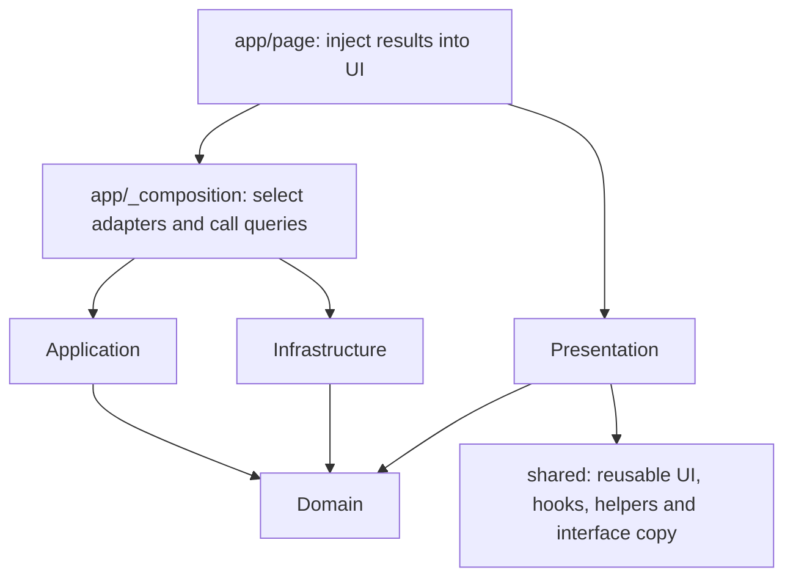

# Feature-Based + Clean Architecture

Features own capabilities; layers keep business/data logic independent of the UI
and storage implementation. All application code uses `.tsx`. JSON content and
CSS Modules retain their native formats.

## Dependency direction



Arrows mean source dependencies. Application queries receive repository
implementations as arguments; they import only the repository contracts from
their feature's domain. Reading data flows through those contracts, without
application code importing concrete infrastructure.

## Feature ownership

| Feature                                  | Responsibility                                               |
| ---------------------------------------- | ------------------------------------------------------------ |
| `profile`                                | Profile, employment and hero captions; no presentation layer |
| `timeline`                               | Career records, cards, traveler and measured journey route   |
| `work`                                   | Project records, section and reusable project card           |
| `skills`                                 | Grouped skill source, ordered catalog generation and display |
| `hero`, `about`, `principles`, `contact` | Presentation; data arrives through props                     |

A data-backed feature uses:

```text
feature/
  domain/                  # Models and repository interfaces
  application/             # Queries/use cases using injected interfaces
  infrastructure/
    data/                  # Local JSON source
    repositories/          # Implementations of domain interfaces
  presentation/
    components/            # React and adjacent CSS Modules
    hooks/                 # Browser/React state when needed
    lib/                   # View-specific helpers when needed
  index.tsx                # Public presentation and optional domain type exports
  server.tsx               # Public application and adapter exports for composition
```

Create only the layers a feature needs. Animation, DOM measurement, canvas
loading and journey geometry are presentation concerns. The journey route's
mathematics remain in `timeline/presentation/lib` because its input describes
measured card positions, rather than career business rules.

`shared` holds `Section`, lists, navigation/footer, motion components, generic
hooks, formatting, procedural drawing and UI/SEO copy. Profile facts belong to
the `profile` feature. Navigation/footer receive name/email props and have no
dependency on a profile repository or feature.

## Composition and replacement

`src/app/_composition/portfolio.tsx` imports the public `server.tsx` APIs, passes
JSON repositories into the application functions and returns a serializable
portfolio model. The server page passes its fields into public section exports.
Client components receive data as props; they do not load JSON repositories.

To replace a static source, implement the same repository interface and select
the new implementation at the composition root. The current interfaces are
synchronous because all data is local; add async contracts and await composition
when a future requirement actually introduces asynchronous storage.

## Naming conventions

- Use PascalCase for React component files and component/type names, such as
  `ProjectCard.tsx`, `ProjectCard` and `ProjectRepository`. Name adjacent CSS
  Modules `Component.module.css`.
- Use `useCamelCase` for hook files and functions, such as
  `useReducedMotion.tsx` and `useReducedMotion`.
- Use kebab-case for other files and directories, such as
  `get-projects.tsx`, `json-project-repository.tsx` and `earth-moon-orbit.tsx`.
  Keep framework and entrypoint names `page.tsx`, `layout.tsx`, `index.tsx` and
  `server.tsx`; Next.js's private `_composition` directory is an intentional
  exception.
- Use camelCase for variables, functions and repository instances, such as
  `getProjects`, `jsonProjectRepository` and `drawEarthMoonOrbit`. Use
  UPPER_SNAKE_CASE for fixed module constants, such as `HERO_IMAGE`.
- Retain `.tsx` for all application modules. Unit test names match their subject
  with `.test.ts` or `.test.tsx`; browser tests use `.spec.ts`.
  `tests/e2e/portfolio.spec.ts` names the suite covering the full portfolio page.

## Boundary rules and checks

- Domain depends only on its own domain modules. Models must not derive types
  from JSON or import React, Next.js, DOM APIs or infrastructure.
- Application depends only on its own application/domain modules.
- Infrastructure depends only on its own infrastructure/domain modules.
- Presentation depends on its own presentation/domain modules and `shared`.
- Shared does not depend on features or the app. Features do not import peers.
- The app accesses features through `index.tsx` or `server.tsx`, using the
  composition root to choose concrete implementations.

Run `npm run test:architecture` for AST-based dependency checks, or `npm test --
--run` for those checks with the remaining unit suite. Unit tests may inject
in-memory repositories. Browser tests compare the rendered page with saved JSON
facts and cover the existing scrolling, navigation, contact and animation behavior.
